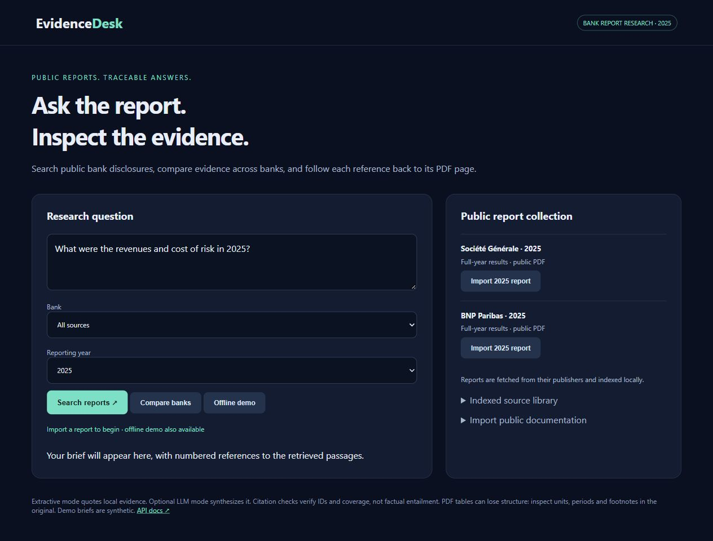

# EvidenceDesk — Bank Report RAG

**A research assistant for public bank disclosures, built with FastAPI, SQLite and an optional LLM.** Import a publisher's PDF, ask questions, compare evidence across banks, and inspect the physical PDF page behind each reference.



## A concrete use case

An analyst reviewing annual bank results needs to find capital, liquidity and operating-performance disclosures without losing the reporting period or source. EvidenceDesk indexes the public **2025 full-year results presentations from Société Générale and BNP Paribas**. These are results presentations, not the complete universal registration documents.

The catalog contains publisher URLs and metadata; the repository contains no copied bank reports. Imports run only when requested and remain local. The reporting-year filter selects a report's year; individual pages can also discuss past periods or future targets.

## Run it

Requires Python 3.11+ with SQLite FTS5.

```sh
python -m venv .venv
# Windows: .venv\Scripts\activate
# macOS/Linux: source .venv/bin/activate
pip install -e ".[dev]"
uvicorn evidence_desk.api:app --reload
# Open http://127.0.0.1:8000
```

1. Click **Import 2025 report** for either bank. Fetching and indexing can take a few seconds.
2. Select a bank and ask a focused question, such as `CET1 liquidity coverage` for Société Générale.
3. Inspect the passage and **Open PDF · page n** link. Page numbers count from the first physical PDF page, including covers.
4. Import both reports and use **Compare banks** to collect evidence independently for each bank. This avoids one report crowding the other out. Missing passages for either bank cause an explicit comparison abstention.
5. **Offline demo** uses three synthetic technical briefs and needs neither network nor an API key.

### Enable generative RAG

Without a model configuration, the app returns **extractive evidence excerpts**. This baseline is retrieval, not LLM generation. Configure a trusted Chat Completions-compatible provider to synthesize a cited answer:

```powershell
$env:LLM_BASE_URL="https://api.openai.com/v1"
$env:LLM_MODEL="your-available-model-id"
$env:LLM_API_KEY="your-key"
uvicorn evidence_desk.api:app --reload
```

`.env.example` documents settings; `.env` is not automatically loaded. LLM mode sends the question and retrieved passages to the configured provider and may incur charges. No key is bundled. The adapter has mocked integration tests; a paid live model call was not run during development.

## Pipeline

```text
Exact publisher catalog → bounded HTTPS fetch → pypdf page extraction
                                               ↓
                      source metadata + content hash + page-level chunks
                                               ↓
Question + bank/year → SQLite FTS5/BM25 → excerpts / optional LLM → page citations
                             ↓                       ↓
                       query metrics          citation validation + fallback
```

- **Ingestion:** two exact PDF URLs; no arbitrary PDF crawler or redirect following. Limits: 20 MB, 200 pages, and a decoded-content check per page. Text-only extraction; no OCR. Python parsing is not a hardened document sandbox.
- **Persistence:** SHA-256 of normalized text, page boundaries and metadata; idempotent imports; atomic replacement of stale search chunks; additive schema migration for existing EvidenceDesk libraries.
- **Retrieval:** overlapping 180-word chunks with 35-word overlap, never crossing PDF page boundaries; BM25 lexical ranking; parameterized bank/year filters; a simple minimum term-overlap gate.
- **Comparison:** up to three retrieved passages per bank with globally unique citation IDs and per-bank coverage counts. Extractive mode returns evidence, not computed financial ratios or a generated comparative analysis.
- **Generation:** evidence-only prompt treating source text as untrusted, citation-ID and paragraph-coverage validation, extractive fallback on invalid responses or provider errors. These checks do not prove factual entailment or eliminate prompt injection.
- **Interface:** accessible form labels, responsive layout, text-only rendering of sources, expandable passages and direct PDF page links.
- **Operations:** Docker image, GitHub Actions tests/build, query-count/latency/mode metrics. No cloud deployment is claimed.

## API

| Endpoint | Purpose |
|---|---|
| `GET /api/reports` | Public report catalog |
| `POST /api/reports/{id}/import` | Fetch and index a catalog PDF |
| `GET /api/sources` | Indexed source hashes and provenance |
| `POST /api/ask` | `{ "question": "CET1 ratio", "bank": "Société Générale", "year": 2025, "k": 4 }` |
| `POST /api/compare` | `{ "question": "cost of risk", "banks": ["Société Générale", "BNP Paribas"], "year": 2025 }` |
| `POST /api/sources/web` | Import HTML from the original documentation allowlist |
| `GET /api/metrics` | Local query count, mean latency and response modes |
| `GET /health` | Health status |

Interactive OpenAPI documentation is at `/docs`.

## Validation

```sh
pytest -q
python evaluate.py
# Opt-in network access; downloads to gitignored data/reports/
python bank_eval.py --download
```

**25 tests** cover page numbering across blank pages, encrypted/malformed PDFs, URL restriction, filtered retrieval, stale-index replacement, database migration, comparison abstention, unique citations, API validation and model fallback. CI runs offline tests, the original synthetic smoke evaluation and a Docker build.

The real-report smoke evaluation uses three manually selected questions with visually checked relevant pages. The initial BM25 baseline finds the selected page within the top five for **2/3 cases (MRR@5: 0.40)**. One unrelated negative query returns no passages. These tiny development cases are not held out, do not evaluate generated-answer correctness, and must not be presented as a production accuracy score. See [evaluation notes](docs/EVALUATION.md).

## Limits and next experiments

PDF table extraction loses columns and can omit rotated text; check the original before interpreting numbers. BM25 can favor repeated glossary terms or division tables over a group summary and misses paraphrases. A passage being retrieved does not establish that it answers the question. Financial definitions, currencies, consolidation scopes and time periods can differ across banks. Next experiments: a larger independently labeled question set, semantic/hybrid retrieval, reranking and claim-level grounding evaluation.

Keep this prototype local. It has no authentication, tenant isolation, request quotas or production-grade document isolation. Query text is logged in the local database. The exact catalog and documentation allowlist reduce fetch exposure but are not a general SSRF guarantee against a compromised host or DNS. Imported material remains subject to publisher terms.

## Sources and technical references

- [Société Générale full-year 2025 results presentation](https://www.societegenerale.com/sites/default/files/resultats-publication/en/2026-02/q4-2025-financial-results-presentation.pdf)
- [BNP Paribas full-year 2025 results presentation](https://cdn-group.bnpparibas.com/uploads/file/Slides_BNPP_4Q25_Results_EN.pdf)
- [pypdf extraction documentation](https://pypdf.readthedocs.io/en/stable/user/extract-text.html)
- [SQLite FTS5 / BM25](https://www.sqlite.org/fts5.html)
- [FastAPI](https://fastapi.tiangolo.com/)

Built by Arthur Coltro de Andrade as a portfolio project. No affiliation with either bank, client outcomes or professional deployment is claimed.
