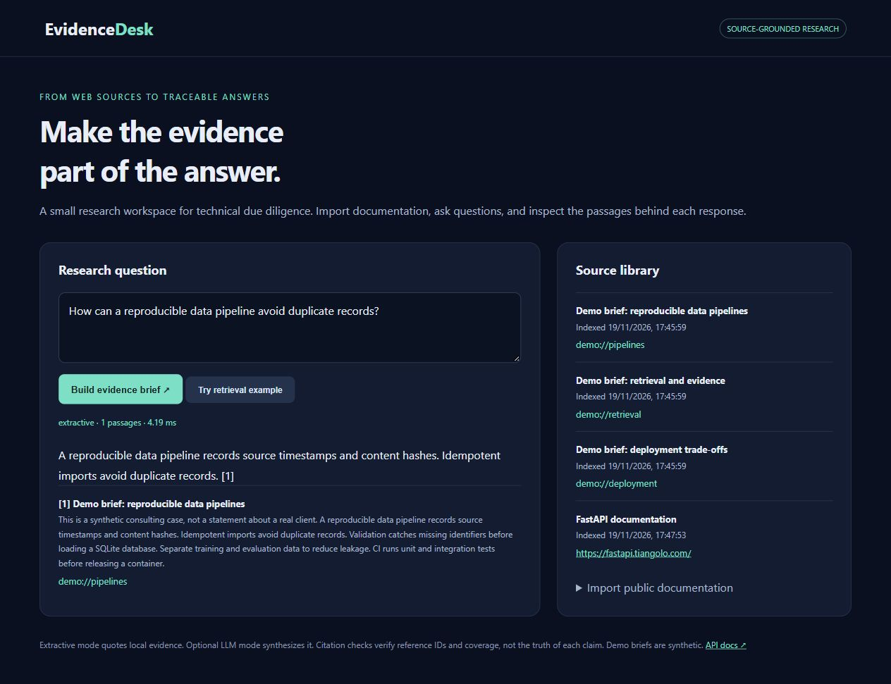

# EvidenceDesk

**A source-grounded research workspace for technical consulting.** Import public documentation, ask a question, and inspect the passages, URLs, fetch timestamps and content hashes behind the answer.



## Run locally

```sh
python -m venv .venv
# Windows: .venv\Scripts\activate
# macOS/Linux: source .venv/bin/activate
pip install -e ".[dev]"
uvicorn evidence_desk.api:app --reload
# Open http://127.0.0.1:8000 (interactive API: /docs)
pytest -q
# Optional: pip install -r requirements-tested.txt
python evaluate.py
```

Docker: `docker build -t evidence-desk .` then `docker run --rm -p 127.0.0.1:8000:8000 evidence-desk`. Mount a writable `/app/data` volume if persistence across containers is needed.

## What it does

- Imports HTML from a small allowlist of public documentation hosts, with timeout, response-size limit and redirects disabled.
- Stores sources, SHA-256 hashes, overlapping chunks and query metrics in SQLite. Reimporting identical text is idempotent; changed sources replace stale chunks atomically.
- Retrieves passages using SQLite FTS5/BM25. No embedding download or paid service is needed.
- Returns an **extractive evidence brief** by default. This is retrieval plus selected passages, not generative RAG.
- Offers genuine retrieval-augmented **LLM generation** when `LLM_API_KEY` and `LLM_MODEL` are set in the process environment. `LLM_BASE_URL` supports a trusted Chat Completions-compatible endpoint. `.env.example` documents settings; `.env` is not automatically loaded.
- Checks generated citation IDs and paragraph coverage. Invalid output or a provider failure falls back to extractive mode. This check does **not** establish factual entailment.
- Exposes FastAPI endpoints and a responsive, framework-free research interface. Source content is rendered as text, not executable HTML.

```text
Public documentation → bounded fetch → HTML text → source hash + chunks
                                                  ↓
Question → FTS5/BM25 retrieval → extractive brief / optional LLM → citations
                                  ↓
                           SQLite run metrics
```

## Try it

The first launch loads three **synthetic educational briefs**, explicitly labeled `demo://`. Try “How can a reproducible data pipeline avoid duplicate records?” or import `https://fastapi.tiangolo.com/` and ask about its features. Demo data is deliberately small; `evaluate.py` reports three handwritten retrieval smoke cases, not evidence of production accuracy.

| Endpoint | Purpose |
|---|---|
| `GET /health` | Service status |
| `GET /api/sources` | Source provenance and allowed hosts |
| `POST /api/sources/web` | Import `{ "url": "…", "title": "…" }` |
| `POST /api/ask` | Ask `{ "question": "…", "k": 4 }` |
| `GET /api/metrics` | Query count, mean latency, generation modes |

## Engineering choices and limits

SQLite keeps a small portfolio app inspectable. BM25 provides a transparent lexical baseline, but misses paraphrases and multilingual equivalence. Next experiments: a labeled evaluation set, embeddings and hybrid retrieval, reranking, and claim-level grounding evaluation. Chunk size is 180 words with 35-word overlap. Stopwords are removed; multi-term questions require at least two matching content terms per returned chunk. This is a simple lexical relevance gate, not a calibrated confidence estimate.

Keep this prototype local. It has no authentication, tenant isolation, quotas or production crawler. Query text is logged locally; LLM mode transmits the question and retrieved passages to your configured provider and may incur charges. Do not load confidential documents without appropriate approval. The web importer strips scripts and ignores source instructions in the generation prompt, but prompt injection is not solved. Allowlisting is a narrow risk reduction, not a general-purpose SSRF guarantee against compromised DNS or hosts. Imported material remains subject to its publisher's terms.

## Technical references

- [SQLite FTS5 / BM25](https://www.sqlite.org/fts5.html)
- [FastAPI documentation](https://fastapi.tiangolo.com/)
- [Chat Completions API](https://developers.openai.com/api/reference/resources/chat/subresources/completions/methods/create)

Built by Arthur Coltro de Andrade as a portfolio prototype. No real client outcomes or production deployment are claimed.
